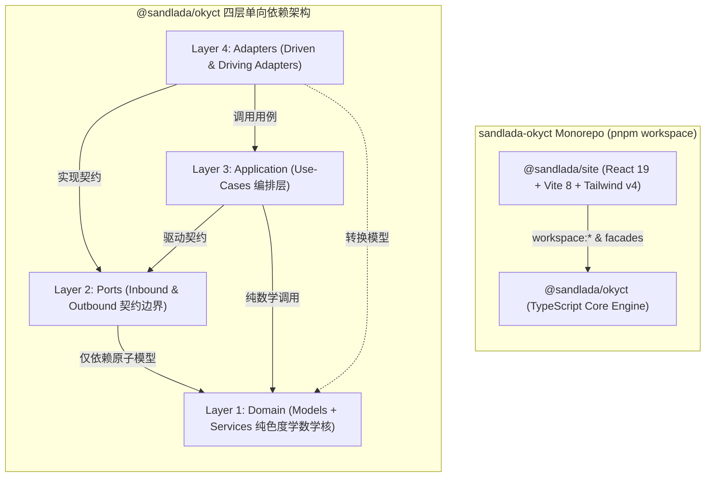

# OKYCT — AI 编码代理指南

> 产品名：**OKYCT**（Monorepo 与多语言生态统称 `okyct`）｜ NPM 全称：`@sandlada/okyct`（暂未发布）｜ 前端工作台：**OKYCT Studio**（`@sandlada/site`）
> 自研 OKYCT 感知色彩模型与自发光动态配色系统，集成自发光显示物理优化（OLED / AMOLED / MicroOLED）、WCAG 2.1 / APCA 双对比度保证，借鉴 MCU 变体与按需定制 MD3 CSS Tokens 规范。
> 本文件为整个代码库的**架构唯一权威声明（SSOT）**；所有 AI 编码代理必须严格遵守本文档所规定的分层边界、编码范式、数学不变量与架构取舍。

---

## 1. 项目定位与技术栈

### 1.1 项目定位、生态命名与使命

OKYCT 是 Sandlada 打造的自研感知色彩模型与自发光动态配色系统：
- **产品命名与多语言生态规划**：
  - 本产品的官方名称为 **OKYCT**。
  - TypeScript 核心引擎 NPM 包全称为 **`@sandlada/okyct`**（目前处于内部开发阶段，尚未正式对外发布）。
  - 项目未来还将陆续发布 **Dart**（面向 Flutter 生态）、**Rust**（面向高性能系统与底层渲染管线）等其他编程语言的算法实现；因此，包含所有核心实现与工具链的整个多语言项目统称为 **`okyct`**。
  - 前端可视化工作台应用（位于 `packages/site`）在用户界面（UI）与产品宣传中的名称统一为 **「OKYCT Studio」**（严禁使用旧代号 ChromaForge）。

- **核心使命与解决痛点**：
  OKYCT 旨在解决传统 UI 配色系统（基于 sRGB、HSL、传统 CIELAB 甚至原生 Google HCT/CAM16）在自发光高刷显示器与无障碍排版中的物理与感知缺陷：
  1. **感知保真度**：克服 CAM16 在蓝紫区域（$240^\circ \sim 300^\circ$）逆向色相扭曲与蓝变紫（Abney 效应）。
  2. **计算性能**：替代 Google HCT 嵌套双重二分搜索（双重 Transcendental 算子），以单变量牛顿切线法实现 $4 \sim 5$ 倍极速收敛，纯 TypeScript 运行无外部依赖。
  3. **显示物理工程**：提供真实的 OLED / AMOLED / MicroOLED 面板物理特性映射（消除 120Hz 滑动果冻黑拖影、抑制蓝色有机发光材料过快老化烧屏、消除 XR Pancake 透镜内反射眩光）。
  4. **数学级无障碍保证**：Tone 与 CIE 1931 $Y$ 严格双射，WCAG 2.1 与 APCA 对比度完全独立于色相，提供 $O(1)$ 代数闭式反求。

### 1.2 MCU 与 MD3 借鉴范围说明

OKYCT 并非复刻 Google Material Color Utilities (MCU) 算法库与面向对象类层次结构，而是保持极简数学核与纯函数范式，**仅借鉴**了 MCU 与 Material Design 3 的三项核心设计资产：
1. **Variant 配色策略思想**：借鉴变体分类理念（如 `tonalSpot`、`vibrant`、`expressive`、`neutral`、`monochrome`、`fidelity` 等色相与色度偏好），用于根据种子色生成多套不同调性的调色板。
2. **对比度区间连续调节设计 (-1.0 ~ 1.0)**：借鉴连续对比度缩放因子的交互与计算维度（`contrastLevel: -1.0 ~ 1.0`），动态伸缩前景与背景的 Tone 明度差。
3. **Material Design 3 CSS Tokens 令牌设计**：借鉴其系统色彩命名规范与角色语义体系（如 `--md-sys-color-*`）。由于官方 MD3 CSS Tokens 体系庞大，本项目由开发者按需维护自定义的精简 Tokens 列表，只生成实际需要的 Tokens，绝不机械生成多余无用的 Tokens。

OKYCT 的核心始终建立在自研的感知色彩科学（OKLab 极角 + CIE Y Tone）、单变量牛顿切线快速求解器、自发光面板物理优化与 $O(1)$ 闭式无障碍对比度代数求解之上。

### 1.3 技术选型清单

- **Monorepo 管理**：`pnpm` (v12.18+)，采用 `pnpm-workspace.yaml` 管理核心包与应用。
- **核心色度引擎 (`packages/typescript` -> `@sandlada/okyct`)**：
  - **语言与标准**：TypeScript 7.0+ / ES2022 / ESNext，严格遵循 ESM 原生模块化规范（`"type": "module"`）。
  - **依赖哲学**：**零外部重型运行时依赖**（Zero external dependencies），纯数学与色度学算法实现。
  - **架构模式**：经典四层六边形架构（Hexagonal / Ports & Adapters Architecture），强制单向依赖反转。
  - **构建与检查**：`tsc` 类型检查与声明生成。
- **色彩科学工作台 (`packages/site` -> `@sandlada/site`)**：
  - **定位与实现**：基于 React 19 + Vite 8 + Tailwind CSS v4 的色彩科学工作台「OKYCT Studio」。
  - **详细指南**：完整前端架构、UI 视图体系、兼容门面层（`src/color/`）与编码规范详见 **[packages/site/AGENTS.md](./packages/site/AGENTS.md)**。

### 1.4 构建与工作区命令规范

所有构建、开发与代码检查指令已在根目录 `package.json` 统一定义，禁止跨目录穿透执行。完整命令清单、参数说明与本地开发流程请参阅 **[CONTRIBUTING.md](./CONTRIBUTING.md)**。

---

## 2. 宏观架构与分层守卫

代码库采用单向六边形架构（Hexagonal Architecture / 端口与适配器模式），分为四层。



### 2.1 四层分层职责与单向依赖约束

| 分层 | 目录路径 | 允许依赖 | 严禁依赖 | 职责与契约粒度 |
|---|---|---|---|---|
| **Layer 1: Domain** | `src/domain/` | **无（零外部依赖）** | `ports`, `application`, `adapters`, 外部 NPM 库 | **纯色度学数学核**：单模型单文件 (`models/*`) 与无副作用无状态转换/对比度/色域服务 (`services/*`)。 |
| **Layer 2: Ports** | `src/ports/` | `domain` | `application`, `adapters`, 外部 NPM 库 | **契约边界层**：驱动端口 (`inbound/*`) 与被驱动端口 (`outbound/*`)，一个端口对应一个独立契约文件。 |
| **Layer 3: Application** | `src/application/` | `domain`, `ports` | **`adapters` (绝对禁引)** | **应用用例编排层**：TonalPalette、按需定制 MD3 CSS Tokens 动态配色方案、N 层物理/感知叠加用例，通过 Port 实施依赖倒置。 |
| **Layer 4: Adapters** | `src/adapters/` | `domain`, `ports`, `application` | 无 | **驱动与被驱动适配器层**：OLED/MicroOLED 物理模型、多格式代码导出、图像极坐标量化、CAM16 评测与 FP 柯里化算子。 |

### 2.2 架构拓扑守卫 (`architecture-guard.ts`)

核心包内置了 `verifyHexagonalArchitectureBoundaries()` 拓扑自检守卫。
- 自动化校验每个模块的依赖关系，杜绝层级越权（特别是 Application 倒引 Adapters 或 Domain 引入外部依赖）。
- 单模型单文件、单端口单文件：不允许在单个文件中堆砌多个领域的 Interface。

---

## 3. 核心特点与算法引擎

### 3.1 自研 OKYCT 色彩模型

OKYCT 是一种专为自发光数字显示屏与无障碍 UI 优化的正交感知色彩空间：
- **$H$ (Hue)**：色相角度，定义在 OKLab 极坐标平面 $\theta = \operatorname{atan2}(b, a) \in [0, 360)$，具备优异的色相线性度，彻底消除蓝紫色相旋转伪影。
- **$C$ (Chroma)**：感知色度模长 $C = \sqrt{a^2 + b^2} \in [0, \sim0.4]$。
- **$T$ (Tone)**：视明度，严格锚定 CIE 1931 相对亮度 $Y$，定义域 $[0, 100]$，满足：
  $$\text{Tone} = \begin{cases} 903.3 \cdot Y & Y \le 0.008856 \\ 116 \cdot Y^{1/3} - 16 & Y > 0.008856 \end{cases}$$
  $$Y = \begin{cases} \frac{\text{Tone}}{903.3} & \text{Tone} \le 8.0 \\ \left(\frac{\text{Tone} + 16}{116}\right)^3 & \text{Tone} > 8.0 \end{cases}$$

### 3.2 单变量牛顿切线快速求解器

在给定色相角度与目标色度 $(a, b)$ 下，由于相对亮度函数：
$$Y(L) = -0.04058 \cdot l^3 + 1.11225 \cdot m^3 - 0.07167 \cdot s^3$$
是关于 OKLab 亮度 $L$ 的**严格单调递增连续函数**。引擎采用解析一阶导数：
$$\frac{dY}{dL} = -0.12174 \cdot l^2 + 3.33677 \cdot m^2 - 0.21503 \cdot s^2$$
实施单变量牛顿切线迭代法（Newton-Raphson Solver）。实测仅需 $5 \sim 7$ 次迭代即可达到 $10^{-6}$ 的解析精度，无须 Google HCT 的双重嵌套二分逼近，计算耗时仅 $\sim 0.08\,\text{ms}$。

### 3.3 Cusp 尖峰折返色域映射 (Cusp-Anchored Gamut Mapping)

当用户指定高色度或经过色相旋转时，目标颜色可能超出 sRGB 或 Display P3 色域：
- **拒绝简单通道截断（RGB Clipping）**：若直接对超出范围的通道调用 `Math.min(1, Math.max(0, c))`，会导致严重的感知色相扭曲（如鲜亮深红漂移至橘黄、纯蓝泛白发紫）。
- **尖峰折返射线求交**：在固定感知色相角度 $H$ 的垂直剖面上，计算色域外壳尖峰（Cusp），沿恒定色相射线向内收敛色度 $C$，**保证色相角度 $\Delta H \equiv 0^\circ$ 绝对零漂移**。

### 3.4 自发光显示物理优化 (Emissive Display Physics)

针对 OLED / AMOLED / MicroOLED 面板提供硬件级物理映射与遥测：
1. **三面板物理模式**：
   - `oled-true-black`：$T = 0$（`#000000`），像素完全断电，提供极限静态对比度与极致省电。
   - `amoled-anti-smear`：$T = 4$ 亚阈值微起辉，为有机二极管维持偏置电荷，唤醒阶跃时间由 $18.5\,\text{ms}$ 压降至 $1.6\,\text{ms}$，**彻底根除 120Hz 高刷滑动紫色果冻黑拖影**。
   - `micro-oled-xr`：暗色底保持 $T = 8$ 低眩光，同时将高光峰值柔性限幅至 $T = 92$，消除 Pancake 折叠光路透镜内反射光晕（Halation）。
2. **光谱加权子像素功耗模型**：
   $$P_{\text{pixel}} = w_R \cdot R^\gamma + w_G \cdot G^\gamma + w_B \cdot B^\gamma \quad (w_R = 1.05,\, w_G = 0.85,\, w_B = 2.40)$$
   蓝色发光材料量子效率最低、产热与衰减最大，提供高危蓝光区间（$H \in [225^\circ, 305^\circ]$）防烧屏自适应色度平滑约束。

### 3.5 $O(1)$ 无障碍对比度代数求解

由于 Tone 与 CIE $Y$ 完全双射，WCAG 2.1 对比度：
$$\text{Ratio} = \frac{\max(Y_1, Y_2) + 0.05}{\min(Y_1, Y_2) + 0.05}$$
与色相、色度完全解耦。给定背景色 Tone 与目标比例（4.5:1 或 7.0:1），引擎可通过封闭代数方程直接在 $O(1)$ 时间内反求出深色/浅色前景 Tone 阈值，无需任何穷举搜索。同时内置 APCA ($L_c$) 感知对比度模型。

### 3.6 按需定制 MD3 CSS Tokens 动态调色与 N 层感知叠加

- **13 级标准色阶**：$T \in \{0, 10, 20, 30, 40, 50, 60, 70, 80, 90, 95, 99, 100\}$，引入生理感官平滑包络曲线（Chroma Envelope），极高光与极暗部自适应衰减纯度，杜绝过曝与脏浊。
- **按需定制的 MD3 CSS Tokens 方案**：严格遵循 MD3 CSS Tokens 命名与层级体系，项目按需维护自定义 Tokens 列表（支持 Primary / Secondary / Tertiary / Error / Neutral 各角色及 Container、Fixed、Surface 容器阶梯），只生成实际需要的 Tokens，避免无谓冗余。
- **N 层状态叠加与可读性补偿**：在各种状态层（Hover、Focus、Pressed、Dragged）物理或感知叠加后，实时追踪累积色度坐标，输出 WCAG/APCA 达标审计与 Tone 补偿建议。

### 3.7 函数式编程组合子 (FP Currying)

在 `adapters/driving-fp/` 中提供面向流水线工程的柯里化算子：
- 遵循「纯函数 + 高阶函数 + 数据后置（Data-Last / Currying）」，以嵌套调用组合，不另设 `pipe` 或 `flow`。
- 所有变换函数均为 `func(options)(dataLast)` 形式，便于与构建工具链和流式数据直接结合。

---

## 4. 六大核心架构取舍账本 (Trade-Offs Ledger)

以下六项核心架构决策构成了本项目的基石，代码修改必须尊重该账本的得失考量，**严禁为了单一指标擅自打破平衡**：


### 取舍 1：无障碍对比度确定性 VS 极端色度峰值
- **冲突场景**：当用户输入高亮亮黄色（如 `#FFD600`，物理亮度 $Y \approx 0.92$）作为品牌种子色时，若将 Primary 核心操作按钮直接赋予原色明度，其上的白色文字对比度将跌至 $1.3:1$，在实际生产中造成不可读的事故级灾难。
- **架构决策**：Primary 核心操作角色严格锚定至 Tone 40（或反转 OnPrimary 为深黑），原始高饱和鲜亮黄转入 Primary Container（Tone 90）展示。
- **得到 (Gain)**：任何极端种子色输入下，核心组件严格 100% 达成 WCAG AA（4.5:1）与 AAA，彻底杜绝生产排版事故。
- **牺牲 (Sacrifice)**：Primary 按钮背景不能 100% 还原原始输入色的高亮色相，而是呈现高质感浓郁明度。

### 取舍 2：OKLab 正交平面 + Y-Tone VS 完整 CAM16 色貌模型
- **冲突场景**：Google HCT 所采用的 CAM16 色貌模型包含极其繁琐的视网膜暗适应因子与环境光白点变换矩阵，需要双重嵌套二分法求解，客户端计算开销大，且在蓝紫区域存在逆向色相扭曲（蓝变紫）。
- **架构决策**：自研 OKYCT：采用 OKLab 优异的色相线性角度 $(h, c)$ + 锚定物理 $Y$ 的 Tone $(t)$，并以一阶解析导数驱动单变量牛顿切线法。
- **得到 (Gain)**：计算速度提升 4~5 倍，零任何外部重型依赖，蓝紫色阶平滑纯净无伪影。
- **牺牲 (Sacrifice)**：不模拟纸张印刷品在白炽灯与荧光灯下的不同环境色温动态自适应（UI 自发光屏幕场景下无须此项复杂度）。

### 取舍 3：五级 Tone 表面阶梯 VS 传统阴影 / 半透明蒙版
- **冲突场景**：在深色模式下，传统的黑色投影（Drop Shadow）在深黑底色上完全不可见；而使用白色半透明遮罩层会导致底层品牌色发灰、发白、失去纯度。
- **架构决策**：推导 MD3 五级冷暖自适应表面容器（Surface Dim 至 Surface Container Highest，Tone 4 到 22 递进）。
- **得到 (Gain)**：深色模式下卡片、对话框与侧边栏层次清晰分明，零 GPU 阴影重绘与半透明 Alpha 合成性能开销。
- **牺牲 (Sacrifice)**：设计系统切图与样式配置必须映射至对应的 Surface Container Token，不可“一键无脑加黑色阴影”。

### 取舍 4：Cusp 色域尖峰折返裁剪 VS 直接截断 RGB 通道
- **冲突场景**：当调节高色度超出 sRGB 边界时，简单执行 `clamp(0, 1)` 通道截断会导致感知色相发生剧烈旋转（如鲜亮红色直接漂移为橘黄甚至土黄）。
- **架构决策**：自研尖峰锚定折返（Cusp-Anchored Gamut Mapping），在保持 Tone 严格不变的前提下，沿恒定色相角度射线平滑收敛色度至色域边界。
- **得到 (Gain)**：色相绝对零漂移（$\Delta H = 0^\circ$），高光色阶过渡平滑，无色带断层撕裂。
- **牺牲 (Sacrifice)**：在色域死角无法展现超越 sRGB 物理极限的极高纯色（但在 Display P3 设备上可无损拓展）。

### 取舍 5：AMOLED 防黑拖影起辉 (T=4) VS 纯黑极限断电 (T=0)
- **冲突场景**：OLED 纯黑 `#000000` ($T = 0$) 虽然能使像素彻底关断，但在 120Hz 高刷屏快速滑动时，子像素从完全断电唤醒至微亮需要经历 $18\,\text{ms}$ 的寄生电容充放电死区，产生严重的高刷紫色残影与黑拖影（Black Smearing）。
- **架构决策**：不搞一刀切，提供硬件预设：`oled-true-black` ($T=0$)、`amoled-anti-smear` ($T=4$) 与 `micro-oled-xr` ($T=8$)。
- **得到 (Gain)**：在 120Hz AMOLED 上将像素阶跃响应时间从 $18.5\,\text{ms}$ 压缩至 $1.6\,\text{ms}$，彻底消灭果冻黑拖影；同时在静态展示场景仍可一键开启 $T=0$ 极限省电。
- **牺牲 (Sacrifice)**：在防拖影模式下，放弃底层背景约 $2.1\%$ 的极端静态关断断电率，换取动态交互的极致纯净。

### 取舍 6：蓝色子像素防烧屏与 XR 防眩光 VS 刺眼蓝紫高饱和峰值
- **冲突场景**：自发光有机材料中，蓝色子像素内量子效率最低（功耗约为绿光的 2.4 倍）、衰减与老化速度最快；同时 MicroOLED 头显在纯黑背景下显示 $T=100$ 纯白高光时，会产生 Pancake 透镜内反射光晕（Halation）。
- **架构决策**：引入光谱加权功耗模型与蓝光防老化守护（在 $H \in [225^\circ, 305^\circ]$ 高危区间锁定 Tone、自适应收敛纯度并微偏青蓝），并在 MicroOLED 模式下将高光峰值柔性限幅至 $T=92$。
- **得到 (Gain)**：蓝色子像素驱动电流峰值下降 $18\% \sim 30\%$，显著延缓常驻组件差异化烧屏，消除 XR 头显近眼眩光，且 WCAG 对比度 100% 达标。
- **牺牲 (Sacrifice)**：放弃高能耗蓝紫色块在自发光屏上的“刺眼荧光感”，放弃 MicroOLED 上 100% 满幅刺眼白光。

---

## 5. 编码规范与范式

为保持与 Sandlada 整体生态的严苛一致性，必须遵守以下编码规则：

### 5.1 代码风格与格式化

- **TypeScript 一律无行尾分号（No trailing semicolons）**，保持极简现代风格。
- **零托底策略（Zero-polyfilling）**：严禁引入 polyfill、vendor prefix 或向下兼容 patch；基线锁定现代标准环境（Chrome 150+ / ES2022+ / ECMA Next）。
- **错误处理**：一律采用 `throw new Error(...)` 显式抛出异常，**严禁静默吞异常、返回魔法哨兵值或返回错误码**。
- **版权与许可**：整个 Monorepo 统一采用 MIT（见仓库根目录 `LICENSE`）；源码文件中不重复 SPDX 或协议头注释。

### 5.2 命名规范与类型推导

- **顶层常量命名**：模块顶层 `const` 常量（字面量、对象、数组、`as const`）**一律采用 PascalCase 帕斯卡命名**（例如 `StandardTones`、`TradeOffLedger`、`HexagonalArchitectureManifest`）。
  - **严禁使用 `SCREAMING_SNAKE_CASE`**（如禁止 `STANDARD_TONES`）。
  - **严禁顶层常量使用 `camelCase`**（如禁止 `standardTones`）。
  - 局部函数内 `const` 不受此限；可调用结果（函数表达式、工厂调用结果）维持小驼峰。
- **配套类型自动推导**：类型由常量推导，严禁手动手写重复字面量联合：
  - 对象常量类型：`export type X = (typeof X)[keyof typeof X]`
  - 数组常量类型：`export type X = (typeof X)[number]`
  - 键名联集：`export type XKeys = keyof typeof X`
  - 严禁 `as const satisfies Record<string, X>` 与同名类型并用（避免 TS2456 / TS7022 循环推导错误）。
- **对象常量键名**：`as const` 物件的键名统一用 PascalCase（如 `Standard`, `Light`, `Dark`）。

### 5.3 模块化与导出边界

- **深层导出隔离（Barrel 约定）**：
  - 核心包统一经 `src/index.ts` 导出公共 API，并在 `package.json` 中配置了五个子路径 exports：`.`、`./domain`、`./ports`、`./application`、`./adapters`。
  - 外部引用必须使用具名子路径或根入口，严禁深层穿透导入私有内部文件（如禁止从业务层直接相对路径引入 `domain/services/internal/solve-oklab-l-for-target-y.ts`）。
  - 前端包 `packages/site` 消费核心库时，使用 `@sandlada/okyct` 或通过 `packages/site/src/color/` 兼容门面引用。
- **模块内公开 API vs `internal/`**：
  - 每个六边形子模块（如 `domain/services`、`application`、`adapters/driven-exporters`）仅通过本模块的 `index.ts` 对外暴露公共 API。
  - **一公开 API 一文件**：每文件至多一个 `export function`；`export class` 独占该文件；柯里化算子使用 `export const` 且每个算子单独文件；同文件允许多个 `export const`（常量表、默认实例）及非导出局部函数。
  - **`internal/` 目录**：仅存放同模块内跨文件复用、且不属于公共面的辅助函数；**不设** `internal/index.ts`；只允许本模块内用带 `.ts` 后缀的文件路径直接导入；**严禁**任何 `index.ts` 再导出 `internal/`。
  - 同模块内公开文件互相引用时按文件导入，避免绕回本模块 `index.ts` 造成桶循环；跨层仍只从对方模块 `index.ts` 进入。

---

## 6. 验证、测试与避坑指南

### 6.1 色度学数学不变量自检套件 (`run-colorimetric-invariant-suite.ts`)

修改色度学算法后，必须通过数学不变量自检：
```typescript
import { runColorimetricInvariantSuite } from '@sandlada/okyct'

const results = runColorimetricInvariantSuite()
console.log(results)
```
自检验证三大数学基石：
1. **双向往返还原精度**：$sRGB \to OKYCT \to sRGB$ 往返误差 $\Delta E < 10^{-4}$。
2. **单调性与双射反演**：$\text{Tone} \leftrightarrow \text{CIE } Y$ 严格单调递增，反演误差为 0。
3. **360° 全色相环 Cusp 折返色相保持**：全色相环任意高饱和输入在色域折返后，感知色相漂移 $\Delta H < 0.1^\circ$ 且 RGB 无任何溢出越界。

### 6.2 常见踩坑点 (Gotchas)

1. **不要在 Domain 层引入任何外部库**：Domain 层必须是纯净的数学与模型，任何与 Node、DOM、第三方颜色库相关的调用都应放在 Adapters 层。
2. **不要直接截断 RGB 通道**：需要做色域边界处理时，务必调用 `findMaxChromaForTone` 或 `okyctToRgb` 内置的 Cusp 折返逻辑，直接 clamp 通道会导致色相严重漂移。
3. **暗色背景不要误设为纯白字的绝对反转**：在暗色模式下，背景采用 Surface 阶梯（Tone 4 ~ 22），而不是非黑即白；文字也需采用 OnSurface（Tone 90）而非刺眼的 Tone 100 纯白。
4. **Vite 配置中的别名与 TS 扩展名**：项目已开启 `allowImportingTsExtensions: true` 与 `isolatedModules: true`，编写 import 路径时需带上完整 `.ts` 扩展名。
