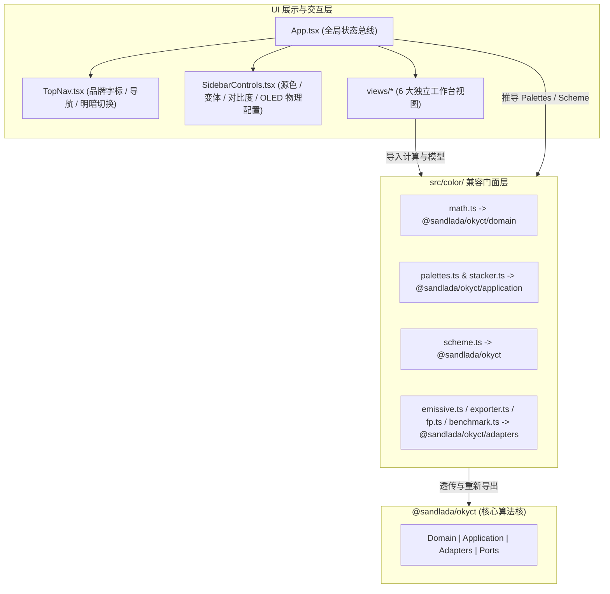

# OKYCT Studio — AI 编码代理指南

> 产品名：**OKYCT Studio**（包名：`@sandlada/site`）｜ 核心色度引擎：`@sandlada/okyct`
> 基于 React 19 + Vite 8 + Tailwind CSS v4 的自研 OKYCT 感知色彩科学与自发光动态配色系统可视化工作台。
> 本文件为前端工作台的**架构唯一权威声明（SSOT）**；所有涉及前端 UI、组件视图、兼容门面与交互状态的 AI 代理必须严格遵守本文档所规定的分层边界与编码范式。

---

## 1. 项目定位与技术栈

### 1.1 项目定位与命名规范

- **官方命名**：
  - 本前端工作台官方名称统一为 **「OKYCT Studio」**（包名 `@sandlada/site`）。
  - **严禁使用旧代号 ChromaForge**，包括 UI 界面文字、组件命名、注释、文档及代码变量。
- **与核心引擎的关系**：
  - OKYCT Studio 是 OKYCT 色彩模型的官方可视化交互实验室与参考实现。
  - 通过 Monorepo `workspace:*` 消费核心包 `@sandlada/okyct`，在 `vite.config.ts` 中配置了子路径别名直接映射至源码。

### 1.2 技术选型清单

- **前端框架**：React 19.3+（严格遵循函数式组件与 Hook 纯函数范式）。
- **语言与环境**：TypeScript 7.0+ / ES2022 / ESNext，现代 ESM 原生规范。
- **构建工具**：Vite 8.3+，现代原生 ESM 极速构建。
- **UI 与样式**：Tailwind CSS v4 (`@tailwindcss/vite`) + 现代 CSS 自定义属性（`--okyct-*` 令牌前缀）。
- **物理动画**：Motion (v12.23+) 用于状态平滑过渡与面板物理交互。
- **图标系统**：Lucide React (v0.546+)。
- **AI 赋能**：`@google/genai` (v2.4+) 用于 Gemini 语义色与配色推导演示。

### 1.3 构建与开发命令

工作台的构建与开发脚本由根目录统一编排，严禁在子包内随意私自执行未经定义的命令。具体命令请参阅根目录 **[CONTRIBUTING.md](../../CONTRIBUTING.md)**：
- 启动工作台本地开发服务：`pnpm dev:site`（或 `pnpm dev` 同时启动）
- 构建工作台生产包：`pnpm build:site`
- 执行类型安全检查：`pnpm --filter @sandlada/site lint`

---

## 2. 前端架构与目录职责

OKYCT Studio 采用清晰的「状态提升 + 视图装配 + 兼容门面」三层架构：

### 2.1 全局状态总线 (`src/App.tsx`)

`App.tsx` 充当整个工作台的数据上下文与响应式调度中心，实行**单向数据流**：
1. **输入状态维护**：
   - `sourceHex`: 品牌种子色（十六进制字符串，如 `#1A73E8`）。
   - `variant`: 配色变体策略（`tonalSpot`, `vibrant`, `expressive`, `neutral`, `monochrome`, `fidelity` 等）。
   - `contrastLevel`: 连续对比度等级（`-1.0 ~ 1.0`，0.0 为标准）。
   - `emissiveProfile`: 自发光面板物理调校模式（`oled-true-black`, `amoled-anti-smear`, `micro-oled-xr`）。
   - `burnInGuard`: 蓝色发光材料防烧屏开关。
   - `antiFringing`: Pancake 透镜防眩光光晕开关。
   - `cvdType`: 色盲模拟类型（`none`, `protanopia`, `deuteranopia`, `tritanopia`）。
   - `customColors`: 用户动态添加的扩展业务/品牌语义色。
2. **派生数据纯计算 (Memoized)**：
   - 源色坐标：`okyct = hexToOkyct(sourceHex)`
   - 8 大调色板集合：`palettes = createPalettesFromSource(sourceHex, variant, harmonize)`
   - 当前动态方案：`scheme = buildDynamicScheme(palettes, isDark, contrastLevel, emissiveOpts)`
   - 导出双方案：`lightScheme` 与 `darkScheme`

### 2.2 六大工作台视图 (`src/components/views/`)

| 视图文件名 | 视图名称 | 核心职责 |
|---|---|---|
| **`SandboxView.tsx`** | **实时组件沙盒** | 渲染 MD3 角色阶梯（Primary / Secondary / Tertiary / Error / Surface 容器），演示按钮、卡片、输入框与状态层叠加。 |
| **`EmissiveLabView.tsx`** | **自发光硬件仿真** | 演示 OLED 极限纯黑断电、AMOLED 防黑拖影微起辉（$T=4$）、MicroOLED XR 防眩光，实时遥测光谱加权子像素功耗（$P_{\text{pixel}}$）。 |
| **`ColorimetricView.tsx`** | **色度学与色域分析** | 深度解析 CIE 1931 $Y$、Tone 双射曲线、OKLab 正交平面极坐标投影与 360° Cusp 色域尖峰折返外壳。 |
| **`FpPlaygroundView.tsx`** | **函数式组合子操场** | 演示柯里化管道算子（`pipe` / `flow`）与数据后置变换，直观展示流式色彩数据处理过程。 |
| **`BenchmarkView.tsx`** | **色彩模型基准评测** | 对比 OKYCT、CAM16 与原生 sRGB 的色貌表现、蓝紫伪影规避度及色差辨析。 |
| **`TokenExportView.tsx`** | **多格式代码导出器** | 导出按需定制的 MD3 CSS Tokens（`--md-sys-color-*`）、JSON、Tailwind 配置与移动端适配代码。 |

### 2.3 兼容门面层 (`src/color/`)

位于 `packages/site/src/color/` 的门面模块具有关键的**解耦保护作用**：
- **设计初衷**：隔绝核心库六边形架构演进对前端上层视图的冲击，向组件提供向后兼容、结构扁平的透明导出。
- **模块映射关系**：
  - `math.ts` $\to$ `@sandlada/okyct/domain`
  - `palettes.ts` $\to$ `@sandlada/okyct/application`
  - `stacker.ts` $\to$ `@sandlada/okyct/application`
  - `scheme.ts` $\to$ `@sandlada/okyct`
  - `emissive.ts` $\to$ `@sandlada/okyct/adapters`
  - `exporter.ts` $\to$ `@sandlada/okyct/adapters`
  - `fp.ts` $\to$ `@sandlada/okyct/adapters`
  - `imageQuantizer.ts` $\to$ `@sandlada/okyct/adapters`
  - `benchmark.ts` $\to$ `@sandlada/okyct/adapters`
- **开发约束**：严禁在 `src/color/` 中直接编写业务逻辑；若需要添加新的色度学算法或用例，必须下沉至 `@sandlada/okyct` 核心包，再由门面层重新导出。

---

## 3. 样式、令牌与主题规范

### 3.1 Tailwind CSS v4 与自定义样式

- 样式方案采用 Tailwind CSS v4，主入口为 `src/index.css`。
- 遵循原生 CSS 自定义属性优先原则，动态计算的颜色直接以 CSS 变量注入宿主元素或组件根节点。
- 所有动态令牌前缀统一为 `--okyct-*`（如 `--okyct-primary`、`--okyct-surface`）。

### 3.2 明暗主题切换与 DOM 注入

- 切换暗色模式时，必须通过 `document.documentElement.classList.toggle('dark', isDark)` 切换根节点类名。
- 遵循 OKYCT 架构取舍：暗色模式采用五级 Surface Container 阶梯（Tone 4 ~ 22），**严禁使用粗暴的纯白反转或非黑即白的刺眼反差**。

---

## 4. 编码规范与范式

为保持与 Sandlada 全局工程标准一致，前端代码必须严格遵守以下规则：

### 4.1 代码风格

- **TypeScript 一律无行尾分号（No trailing semicolons）**。
- **零托底策略（Zero-polyfilling）**：锁定现代标准浏览器（Chrome 150+ / ES2022+ / ECMA Next），严禁引入 polyfill 或已废弃的兼容 hack。
- **显式错误抛出**：异常逻辑必须使用 `throw new Error(...)`，严禁静默吞掉异常或使用魔法哨兵值替代错误。

### 4.2 命名规范与类型推导

- **顶层常量命名**：模块顶层 `const` 常量（字面量、配置对象、数组、`as const`）**一律采用 PascalCase 帕斯卡命名**。
  - 严禁顶层常量使用 `SCREAMING_SNAKE_CASE`（禁止 `DEFAULT_SOURCE_HEX`）。
  - 严禁顶层常量使用 `camelCase`（禁止 `defaultSourceHex`）。
  - 组件局部内部 `const` 遵循标准 React 惯用法。
- **配套类型自动推导**：
  - `export type X = (typeof X)[keyof typeof X]` 或 `export type X = (typeof X)[number]`。
  - 严禁手动重复手写字面量联合。

### 4.3 模块导入约定

- 本地源码别名统一使用 `@/...`（映射至 `packages/site/src/...`）或相对路径（带 `.tsx` / `.ts` 扩展名）。
- 核心引擎引用可直接通过 `@sandlada/okyct` 具名子路径或通过 `src/color/*` 兼容门面导入。

---

## 5. 验证与调试指南

在提交对前端代码的修改前，必须完成以下检查：
1. **类型检查**：运行 `pnpm --filter @sandlada/site lint`（即 `tsc --noEmit`），必须确保 0 错误。
2. **构建验证**：运行 `pnpm --filter @sandlada/site build`，确保 Vite 生产打包顺利完成无任何打包报错。
3. **UI 纯洁性核对**：检查所有页面文字，绝对不可出现 `ChromaForge` 旧代号。
